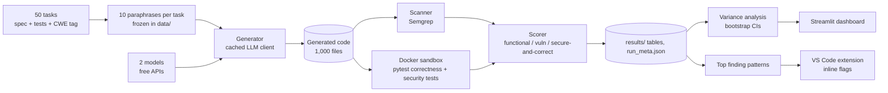

# PLAN.md: CodeTrust

A benchmark plus VS Code extension that measures how secure and correct LLM-generated web-app code is, and how much that changes when the same request is worded differently.
Budget: 7 weeks of evenings and weekends, free compute (laptop, phone), free APIs, free hosting, about 8 GB RAM for Docker.

**Change, 2026-11-25 (owner's decision):** CodeQL, Mistral and OpenRouter were removed because their terms need a permission or condition we have not got (see the README's licence section). The benchmark now uses Semgrep and two model providers. BUILD_STEPS.md still quotes the original prompts; this plan wins.

## Scope

| Area | Decision |
|---|---|
| Task set | **50 web-app tasks**, self-written, each with a short spec, a function/route signature, a **correctness test** (pytest) and, where the task has a security-relevant surface, a **security test** (a harmless exploit-style check, e.g. a quote-laden SQL input or `../` path). Tasks span 10 CWE-tagged vulnerability families, about 5 tasks each: SQL injection (CWE-89), XSS (79), path traversal (22), OS command injection (78), hard-coded secrets (798), weak crypto/hashing (327/328), missing authentication/authorization (306/862), SSRF (918), insecure deserialization (502), unsafe file upload / open redirect (434/601). Public benchmarks (SecurityEval, LLMSecEval, CyberSecEval, HumanEval) are used for **reference and sanity-checking only**; no task is copied. |
| Language | **Python (Flask) only for the core benchmark**, so one toolchain scores everything. JavaScript/Express tasks and Jest are a stretch goal after Step 6, not part of the 7-week commitment. (Jest is dropped from the committed stack; see Simplifications.) |
| Paraphrases | **10 prompt variants per task** = 500 prompts: 1 canonical wording plus 9 variants along fixed axes (formality, level of detail, terse vs. verbose, user story vs. imperative, mentions of "secure"/no mention, non-native phrasing, typo-laden, role-play "senior dev", extra irrelevant context). Variants are drafted with an LLM **once**, then hand-reviewed and frozen in `data/` with a check that none of them names a security measure that the canonical prompt does not (except the explicitly labelled "mentions secure" axis). Frozen files are the dataset; they are never regenerated silently. |
| Models (2) | Free-tier APIs only: **Groq** (Llama-family, `CODETRUST_GROQ_API_KEY`) and **Google Gemini** unpaid tier (`CODETRUST_GEMINI_API_KEY`). Exact model IDs, limits and availability are **verified before the pilot** and recorded in `results/run_meta.json`. If a free tier is dropped mid-project the cached results stay valid and a replacement is documented. Any added model or provider needs its terms read first. |
| Volume | 50 x 10 x 2 = **1,000 generations** per full run, at roughly 600 output tokens each = about 0.6M output tokens plus prompts, spread over two providers. Temperature fixed (default 0.2, recorded), seed passed where the API supports it. A second sampling at higher temperature on a subset estimates sampling noise vs. wording noise (see Metrics). |
| Scanners | **Semgrep** with rules written for this project (`data/rules/`), run on generated files only, never on real code. Findings are mapped to the 10 CWE families. A finding counts only if it matches the task's family or is high-severity in any family (reported separately). |
| Scoring per generation | `functional_pass` (correctness tests), `scanner_vuln` (Semgrep finding in scope), `exploit_vuln` (security test shows the attack succeeds), and the combined **secure-and-correct** flag. All automatic. **No LLM judge.** Code that does not parse or import is scored as functional fail, not dropped. |
| Sandbox | Generated code runs only in a throwaway Docker container: no network, read-only root filesystem, CPU/memory/time limits, non-root, empty environment, temp working directory. Tests use a Flask test client against an in-memory SQLite DB with synthetic data. Scanning needs no execution. Nothing generated ever touches a real service or real data. |
| Variance analysis | Per model and per CWE family: mean secure rate, **spread across the 10 paraphrases of the same task** (within-task variance, range, share of tasks with mixed outcomes), compared against **resampling noise** (same prompt repeated 3 times at the test temperature). Uncertainty by task-level bootstrap (prompts for one task are not independent). A variance statistic is only reported with its CI. |
| Dashboard | **Streamlit**, reading precomputed result files (no live LLM calls needed to browse). Views: per model, per CWE family, per paraphrase axis, task drill-down showing code, findings and test output. |
| VS Code extension | **TypeScript**, flags risky patterns in AI-inserted code inline (diagnostics + hover). To stay cheap and offline it ships a **small set of fixed Semgrep-style pattern rules derived from the benchmark's most common findings**, run by a bundled lightweight matcher (no Semgrep install needed for users), with an optional "use local Semgrep" setting. It marks suggestions detected from inline-completion/paste events, with a manual "scan selection" command as the reliable fallback. Never sends code anywhere; no telemetry. Marketplace publishing needs a publisher account (see Risks). |
| Backend | None. Results are files (`results/*.parquet|csv|json`). Streamlit reads them. |
| Secrets | Only from `CODETRUST_*` environment variables. Pre-commit gitleaks scan. `.env.example` has names with empty values. |
| Out of scope | Fine-tuning, training a vulnerability classifier, running generated code against anything real, real user code or data, languages other than Python in the core run, an LLM judge, and attacking third-party services. |

## 1. Architecture



- **Tasks and paraphrases** (`codetrust/tasks/`, `data/`): each task is a folder with `spec.md`, `reference_solution.py` (known-good, used to validate the tests themselves), `test_correct.py`, optional `test_security.py` and `meta.json` (CWE family, difficulty). Paraphrases are a frozen JSONL file with their axis labels.
- **Generator** (`codetrust/generate/`): builds the request, calls the cached client, extracts code from the reply (one deterministic extractor, with its failures counted), and stores one record per (task, paraphrase, model, repeat).
- **LLM client** (`codetrust/llm/`): cache keyed on provider, model ID, prompt, temperature and seed; daily/minute budget tracker per provider; resumable runner that stops at 95% of a limit and continues next day. `meta.py` writes `results/run_meta.json`.
- **Scanner** (`codetrust/scan/`): a thin wrapper that runs Semgrep on a directory of generated files and normalises findings to `{file, rule, cwe, severity}`. It runs inside Docker (Linux) because Semgrep's Windows support is limited.
- **Sandbox runner** (`codetrust/sandbox/`): runs each generation against its task's tests in a locked-down container and records pass/fail, timeouts and crashes.
- **Scorer and stats** (`codetrust/score/`, `codetrust/stats/`): joins scanner and test outcomes, computes rates, within-task spread, resampling-noise baseline and task-level bootstrap CIs.
- **Dashboard** (`dashboard/`): Streamlit app over result files.
- **Extension** (`extension/`): TypeScript VS Code extension, own tests with the VS Code test runner and a small fixture set of vulnerable/safe snippets taken from benchmark output.

**Metrics**
- **Functional pass rate** (pass@1 over the correctness tests) per model, task and paraphrase.
- **Vulnerable rate**: share of generations with an in-scope scanner finding or a successful exploit test, reported separately and combined, with 95% bootstrap CIs.
- **Secure-and-correct rate**: passes tests and no finding. The headline number.
- **Prompt sensitivity**: per task, the spread of secure-and-correct across its 10 paraphrases (SD and share of tasks with mixed outcomes), compared against the **resampling-noise baseline** so wording effects are not confused with plain randomness.
- **Scanner agreement**: Semgrep vs. exploit test (Cohen's kappa), to show how much each one misses.
- **Extension quality**: precision/recall of the extension's rules against the benchmark labels on the 30 held-out test tasks (20 dev tasks are used to choose the rules).

**Baselines**: (a) a "reference solution" ceiling (should score secure-and-correct by construction, validating tasks and scanners) and (b) a **"prompt with a one-line security reminder"** variant as the simple mitigation; plus the resampling-noise baseline above.

## 2. Call budget

All figures are estimates, replaced by measurements in Step 4.

| Run | Generations | Notes |
|---|---|---|
| Main grid | 1,000 (50 x 10 x 2) | About 0.6M output tokens plus about 0.2M prompt tokens, split across two providers, so roughly 1 to 2 days per provider at free-tier caps. |
| Resampling-noise subset | 3 repeats x 100 prompts x 2 models = 600 | Cut to 2 repeats first if time runs short. |
| Security-reminder baseline | 500 x 1 model-set subset | Run on 2 models first. |
| Scanning and tests | 1,000+ files | Local, free. |

Everything answered is cached; reruns cost nothing. Offline fallbacks for CI: a **recorded-response fixture** (a few dozen cached generations) so scoring, stats and dashboard tests run with no API at all.

## 3. Repo structure

```
codetrust/
├── codetrust/
│   ├── llm/          # client.py, cache.py, budget.py, client.py, providers.py, meta.py
│   ├── tasks/        # loader.py, validate.py (checks reference solutions pass, flawed ones fail)
│   ├── generate/     # prompts.py, extract.py, runner.py
│   ├── scan/         # runner.py, normalise.py, validate.py
│   ├── sandbox/      # runner.py (Docker), harness.py
│   ├── score/        # scorer.py
│   ├── stats/        # variance.py, bootstrap.py, agreement.py
│   └── config.py
├── data/             # tasks/, paraphrases.jsonl, rules/, licence notes, recorded fixtures
├── dashboard/        # Streamlit app
├── extension/        # VS Code extension (TypeScript): src/, test/, package.json
├── results/          # tables, charts, run_meta.json, data report
├── docs/             # write-up, task catalogue
├── tests/
├── Dockerfile, docker-compose.yml, pyproject.toml, requirements*.txt
├── .pre-commit-config.yaml, .github/workflows/tests.yml
├── .env.example      # CODETRUST_GROQ_API_KEY=  CODETRUST_GEMINI_API_KEY=
└── README.md, PLAN.md, CLAUDE.md, BUILD_STEPS.md, LEARNING.md, PROGRESS.md
```

## 4. Week-by-week

| Week | Goal | Done when |
|---|---|---|
| 1 | Setup and plan checks | Repo, CI, gitleaks, `.env.example`. The 2 model IDs and free-tier limits verified with a tiny test call each. Semgrep runs on a sample file inside Docker. Licences of the reference benchmarks and provider terms checked. Marketplace publisher requirement checked. |
| 2 | Tasks and data | All 50 tasks with specs, correctness tests, security tests and reference solutions that pass; a deliberately flawed solution per family that fails. 500 frozen, reviewed paraphrases. Data report. |
| 3 | Generation | Cached client, budgets, extractor, runner. Pilot on 5 tasks x 10 prompts x 2 models. Full grid started and resumable. |
| 4 | Scanning and scoring | Semgrep wrapper, sandbox test runner, scorer; full grid scored; scanner-agreement check. |
| 5 | Variance analysis and dashboard | Within-task spread, noise baseline, bootstrap CIs; Streamlit dashboard. |
| 6 | VS Code extension and evaluation | Extension with rules from the most common findings, own tests, precision/recall on held-out tasks. Security-reminder baseline run. Charts and limitations. |
| 7 | Ship | Dashboard deployed, dataset release, extension packaged (and published if the account is ready), README, report, portfolio card. No new features. |

## 5. Risks and first checks

1. **Free-tier limits and model churn.** Two free APIs, about 1M tokens, and free models get renamed or removed. *Check first:* current model lists and limits per provider and one real call each. Mitigation: cache everything and pin IDs in `run_meta.json`. With only two models, comparisons between models are narrow; say so in the results.
2. **Licences and tool terms.** Provider and model terms can restrict publishing output. The main Groq and Gemini API terms were read on 2026-11-25; Groq's per-model terms and use policy were not. *Check first:* those, before publishing raw output. Mitigation: raw generations stay out of git until then (release prompts, scores and hashes otherwise), and only rules written for this project are shipped, never Semgrep registry rules.
3. **Scoring validity.** Scanners miss real flaws and flag safe code, and our own tests could be wrong. A noisy scorer would blur the variance result. *Check first:* the reference-solution ceiling, a deliberately vulnerable solution per family, and Semgrep/exploit-test agreement on a hand-checked sample of about 100 generations. Report scanner error rates openly and never claim "secure" beyond "no finding and exploit tests pass".
4. **Tooling on Windows and in CI.** Semgrep on native Windows is limited. *Mitigation:* run it in Docker or GitHub Actions Linux runners; keep the unit-test path (recorded fixtures) independent of it.
5. **Marketplace.** Publishing needs a Microsoft/Azure DevOps publisher account and a personal access token, which are the user's own logins. *Mitigation:* build and package the `.vsix` and publish docs in Step 7, stop only for the account steps. Open VSX is an alternative that needs no Microsoft account.

## 6. Simplifications

- Python/Flask only for the core run; JavaScript/Jest is a stretch goal, not a commitment.
- No backend or database; results are files and the dashboard reads them.
- Extension uses its own small rule matcher instead of requiring users to install Semgrep, and starts with a handful of high-confidence rules.
- Recorded-response fixtures so CI and tests need no API keys or scanners.
- One scoring stage joined from three automatic signals; no LLM judge, no human labelling beyond a 100-sample spot check.

## Concepts (plain language + one reading each)

- **CWE and vulnerability families.** Reading: the CWE Top 25 Most Dangerous Software Weaknesses (MITRE).
- **Static analysis, with its false positives and negatives.** Reading: the Semgrep "how it works" docs.
- **Security of AI-generated code.** Reading: Pearce et al., "Asleep at the Keyboard?" (2021); Perry et al., "Do Users Write More Insecure Code with AI Assistants?" (2022).
- **Public code-security benchmarks.** Reading: SecurityEval, LLMSecEval and Meta's CyberSecEval papers.
- **Prompt sensitivity and measuring variance.** Reading: Sclar et al., "Quantifying Language Models' Sensitivity to Spurious Features in Prompt Design" (2023), and a short bootstrap-confidence-interval primer.
- **Sandboxing untrusted code.** Reading: Docker's security docs (rootless, read-only, no network).
